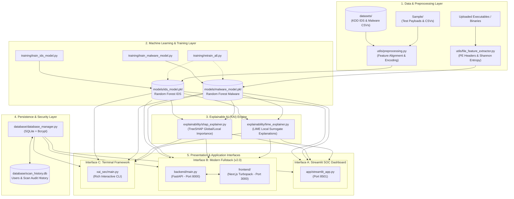

# 🛡️ XAI-Sec: Complete Project Architecture & Directory Structure

> **Explainable AI Cyber Security Framework (XAI-Sec)**  
> Transparent Threat Detection, Malware Analysis & Intrusion Detection with SHAP and LIME.

---

## 🏛️ System Architecture



---

## 📁 Directory & File Map

```text
XAI-Sec-Project/
│
├── app/                          # ── Interface A: Streamlit Dashboard
│   ├── streamlit_app.py          # Main single-file Streamlit SOC application (v1)
│   └── .streamlit/
│       └── config.toml           # Dark SOC theme and server settings
│
├── backend/                      # ── Interface B: FastAPI REST Service (v2.0)
│   ├── main.py                   # FastAPI server entry point, CORS, startup model loader
│   ├── auth_utils.py             # JWT token generation and authentication utilities
│   └── routes/                   # Modular API route controllers
│       ├── auth.py               # /auth (login, register, forgot-password)
│       ├── ids.py                # /ids (traffic scan & sample generation)
│       ├── malware.py            # /malware (file inspection & entropy analysis)
│       ├── history.py            # /history (user scan audit logs)
│       └── models.py             # /models (model metadata & performance metrics)
│
├── frontend/                     # ── Interface B: Next.js Web Application (v2.0)
│   ├── app/                      # Next.js 16 App Router
│   │   ├── page.js               # Landing page & Auth card (Login, Sign-up, Reset Password)
│   │   ├── globals.css           # Global Cyber SOC styling and animations
│   │   ├── (app)/                # Authenticated application views
│   │   │   ├── dashboard/page.js # Overview metrics, real-time posture
│   │   │   ├── ids/page.js       # Network traffic scanner & feature view
│   │   │   ├── malware/page.js   # File upload, sandbox & entropy scanner
│   │   │   ├── insights/page.js  # Global & local SHAP/LIME charts
│   │   │   └── history/page.js   # Scan logs with risk badges
│   │   ├── components/           # Reusable UI widgets (Sidebar, ShapChart)
│   │   └── lib/api.js            # Axios/Fetch client connecting to FastAPI (port 8000)
│   ├── package.json              # React 19, Next.js, Plotly.js dependencies
│   └── next.config.mjs           # Next.js bundler configuration
│
├── xai_sec/                      # ── Interface C: Interactive Terminal Suite
│   ├── main.py                   # Rich terminal CLI menu (Packet capture, Scanners, PDF)
│   ├── ids/                      # Sniffing & live packet detection
│   │   ├── capture.py            # Scapy packet sniffer
│   │   └── detector.py           # Real-time traffic inference engine
│   ├── malware/                  # Binary & signature scanning
│   │   ├── scanner.py            # Static file attribute evaluator
│   │   ├── virustotal.py         # VirusTotal API threat intelligence lookup
│   │   └── yara_scanner.py       # YARA rule-matching engine
│   ├── process_monitor/          # Live OS process watcher
│   │   └── monitor.py            # psutil process scanner & suspicious memory flags
│   ├── reports/                  # Forensic reporting
│   │   └── generator.py          # Automated PDF executive report generator (fpdf2)
│   ├── config/                   # CLI configurations & environment settings
│   │   ├── config.json           # API keys and local paths
│   │   └── settings.py           # Configuration loader & validator
│   └── utils/logger.py           # Rotating system logger
│
├── database/                     # ── Data Persistence & Security
│   ├── database_manager.py       # SQLite connection pool, schema, CRUD & bcrypt operations
│   └── scan_history.db           # SQLite database file (users & scan_history tables)
│
├── explainability/               # ── Core XAI (Explainable AI) Engine
│   ├── shap_explainer.py         # TreeSHAP explainer, feature importance & summary plots
│   └── lime_explainer.py         # Tabular LIME explainer for single-instance predictions
│
├── models/                       # ── Serialized Machine Learning Pipelines
│   ├── ids_model.pkl             # Trained Random Forest classifier for network intrusions
│   ├── malware_model.pkl         # Trained Random Forest classifier for binary malware
│   ├── ids_metrics.json          # Pre-computed evaluation metrics for IDS
│   ├── malware_metrics.json      # Pre-computed evaluation metrics for Malware
│   ├── ids_confusion_matrix.png  # Confusion matrix plot for IDS
│   └── malware_confusion_matrix.png # Confusion matrix plot for Malware
│
├── training/                     # ── Model Training Pipelines
│   ├── train_ids_model.py        # Independent training script for IDS
│   ├── train_malware_model.py    # Independent training script for Malware
│   └── retrain_all.py            # Master retraining pipeline with balanced classes
│
├── datasets/                     # ── Datasets & Dataset Synthesizers
│   ├── generate_datasets.py      # Generates synthetic KDD / Malware datasets if missing
│   ├── ids_dataset.csv           # Master IDS traffic dataset
│   ├── malware_dataset.csv       # Master Malware feature dataset
│   ├── ids_dataset/              # NSL-KDD benchmark training/testing sets
│   └── malware_dataset/          # Raw malware attributes
│
├── utils/                        # ── Shared Engineering Utilities
│   ├── preprocessing.py          # Feature alignment, one-hot encoding, synthetic fallback
│   ├── file_feature_extractor.py # Binary parsing (pefile, entropy, API heuristics)
│   └── visualization.py          # Plotly chart builders (ROC, Confusion Matrix, Bars)
│
├── Sample/                       # ── Benchmark Verification Files
│   ├── ids_test_500.csv          # 500 pre-formatted network traffic records for rapid testing
│   └── malware_features_sample.csv # Sample malware feature vectors
│
├── requirements.txt              # Unified Python dependency manifest
├── start.bat                     # Windows one-click launcher for FastAPI + Next.js
└── README.md                     # High-level project documentation
```

---

## 🔍 Detailed Component Descriptions

### 1. Database & Authentication (`database/database_manager.py`)
- **Engine**: SQLite3 stored in `database/scan_history.db`.
- **Tables**:
  - `users`: `id`, `username`, `email` (UNIQUE), `password` (BLOB), `created_at`.
  - `scan_history`: `id`, `user_id`, `scan_type`, `result`, `confidence`, `timestamp`.
- **Security**:
  - Passwords hashed using `bcrypt.hashpw(password, bcrypt.gensalt())`.
  - Verifications performed via `bcrypt.checkpw(password, stored_hash)`.
  - In-app **Password Reset**: `reset_password(email, new_password)` safely updates records with fresh salt.

### 2. Explainable AI Engine (`explainability/`)
- **SHAP (`shap_explainer.py`)**: Uses Shapley values from cooperative game theory via `shap.TreeExplainer`. Computes how much each feature contributes positively or negatively toward a threat verdict compared to the baseline.
- **LIME (`lime_explainer.py`)**: Uses `lime.lime_tabular.LimeTabularExplainer` to build local linear surrogate models around an individual prediction to explain specific anomalous network packets or executables.

### 3. File Feature Extractor (`utils/file_feature_extractor.py`)
- Analyzes uploaded `.exe`, `.dll`, `.apk`, or binary files.
- Computes **Shannon Entropy**: Identifies packed, obfuscated, or encrypted payloads ($\text{Entropy} > 7.0$).
- Scans for dangerous Windows API strings (`VirtualAllocEx`, `CreateRemoteThread`, `SetWindowsHookEx`, `InternetConnect`).
- Parses Portable Executable (PE) headers using `pefile` (`SizeOfCode`, `AddressOfEntryPoint`, `SectionsMeanEntropy`, `ImportsNbDLL`).

### 4. Three Operational Interfaces
| Interface | Technology | Primary Use Case | How to Start |
| :--- | :--- | :--- | :--- |
| **Fullstack v2** | Next.js 16 + FastAPI | High-concurrency SOC operations, interactive browser dashboards, modern API | Double-click `start.bat` or run `backend/main.py` & `npm run dev` |
| **Streamlit App** | Streamlit 1.30+ | Rapid prototyping, interactive model exploration, single-port all-in-one UI | `streamlit run app/streamlit_app.py` |
| **Rich CLI** | Python Rich + Scapy | Terminal SOC environment, live packet sniffing, OS process monitoring, PDF generation | `python xai_sec/main.py` |

---

## 🚀 How to Run

### Option 1: Full-Stack Web App (Recommended)
Double-click `start.bat` in the project root, or execute:
```bash
# Terminal 1: FastAPI Backend
cd XAI-Sec-Project
.\venv\Scripts\activate
uvicorn backend.main:app --host 0.0.0.0 --port 8000 --reload

# Terminal 2: Next.js Frontend
cd XAI-Sec-Project\frontend
npm run dev
```
- Open [http://localhost:3000](http://localhost:3000) for the UI.
- Open [http://localhost:8000/docs](http://localhost:8000/docs) for the API documentation.

### Option 2: Streamlit Dashboard
```bash
cd XAI-Sec-Project
.\venv\Scripts\activate
streamlit run app/streamlit_app.py
```
- Open [http://localhost:8501](http://localhost:8501).

### Option 3: Terminal CLI Suite
```bash
cd XAI-Sec-Project
.\venv\Scripts\activate
python xai_sec/main.py
```

